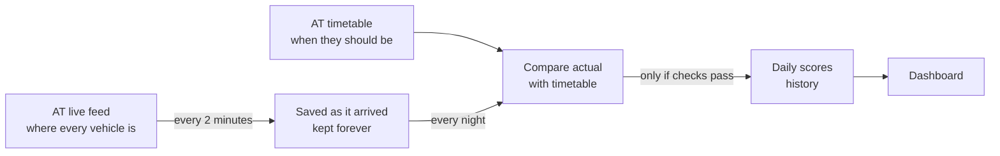

# Auckland Transport Reliability Tracker

Did Auckland's buses, trains and ferries run on time? And if not, where and when?

This project answers that from real data. Every 2 minutes it records where Auckland Transport's vehicles are and how
late they are running. Each night it compares those records with the published timetable and works out how punctual
every route was the day before. The results go into a history that only ever grows, and a dashboard shows them.

## What you can find out

**As a rider**, pick your bus and your stop to get a plain answer like this (numbers for illustration):

> The 70 to Britomart at Panmure is usually 2 min late. 1 in 10 reached the stop 3+ min early, so to be safe,
> be there 3 min before the timetable time. Based on 23 buses.

You also see how it varies by time of day and day of the week, the last 20 buses at that stop, and a live map of
every vehicle on the road right now, coloured by how late it is.

**As a planner or journalist**, you can see which routes are least punctual, where along a route the delays build up,
which hours are worst, how many trips were cancelled, and how each operator compares.

On every chart, blue means early, green on time and red late. A bus counts as on time from 1 minute early to
5 minutes late.

## How it works



1. **Collect.** A small program asks Auckland Transport's free live feed for an update every 2 minutes. That is 720
   requests a day, well inside AT's free allowance of 35,000 a week.
2. **Keep the original.** Every update is saved exactly as it arrived, one folder per day. Nothing is ever changed,
   so any day can be recalculated if the method improves.
3. **Compare.** At 4:30 each morning the previous day's records are cleaned up and matched to the timetable that was
   in force that day. For each stop a bus reached, delay = when it arrived minus when the timetable said it would.
4. **Check.** Before a day is published, automatic checks confirm the data makes sense. If a check fails, the day is
   held back.
5. **Show.** The dashboard reads only days that passed their checks.

## Why the numbers can be trusted

- **Our delays match AT's.** AT's feed includes its own delay figure. On the first evening of data, 100% of our delays
  were within a minute of AT's, which shows the timetable matching works.
- **Almost every vehicle is matched.** 98.8% of live trips were found in the timetable. A day below 95% is not
  published.
- **Nothing is overwritten.** Recalculating a day adds a new version next to the old one, and every result records
  which timetable version it used.
- **Tricky times are tested.** Trips after midnight and the two daylight-saving days have their own automated tests.
- **Gaps are visible.** A "pipeline health" page shows how many updates were collected each day, and an alert goes
  out if no data arrives for 10 minutes.

## Current limits and next steps

| Today | Next step |
| --- | --- |
| Updates every 2 minutes, which catches about 1 stop in 4 per trip. Enough for route scores; single-stop answers need a week or two of data. | Every 30 seconds, once it runs on a cloud server |
| Runs on a laptop, so updates are missed while it sleeps | Move to a free always-on cloud server |
| The live map works only on the computer that collects the data | Serve it from the cloud server |
| Service alerts (roadworks, incidents) are saved but not yet used | Show them next to bad days to explain them |

## Run it yourself

You need a Mac or Linux computer with Python 3.11 or newer, and a free key for the **Realtime Compat** API from the
[AT developer portal](https://dev-portal.at.govt.nz/).

```bash
python3 -m venv .venv && .venv/bin/pip install -r requirements.txt
cp .env.example .env                                # paste your AT key into .env
.venv/bin/python -m tracker.gtfs_load --download    # load the timetable
./run_local.sh                                      # start collecting (Ctrl+C to stop)
.venv/bin/streamlit run dashboard/app.py            # open the dashboard
```

The first scores appear the morning after collection starts. Run the tests with `.venv/bin/python -m pytest`.
