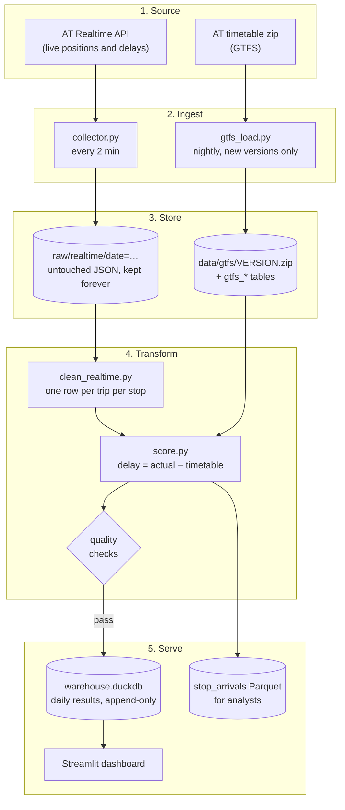

# Technical details

The full engineering reference for the Auckland Transport Reliability Tracker. For a short overview, see the [README](../README.md).

**Did Auckland's buses, trains and ferries run on time, and where and when did they not?**

This project collects Auckland Transport's (AT) live vehicle feed, compares every observed stop against the
published timetable, and produces daily punctuality scores by route, operator, mode and hour. Scores are kept as a
history that is only ever added to, and shown on a dashboard.

It is a data engineering portfolio project. It runs today on a laptop, built so that each part can later move to the
cloud without a rewrite.

- Full requirements and architecture: [`AT Reliability Tracker — Requirements & Architecture.md`](../AT%20Reliability%20Tracker%20—%20Requirements%20&%20Architecture.md)
- Data lifecycle diagram with a worked example: [`docs/data_lifecycle.html`](data_lifecycle.html) (open it in a browser)



---

## Contents

1. [Run it yourself](#1-run-it-yourself)
2. [Who this is for: upstream and downstream](#2-who-this-is-for-upstream-and-downstream)
3. [Requirements and where they stand](#3-requirements-and-where-they-stand)
4. [The data lifecycle, stage by stage](#4-the-data-lifecycle-stage-by-stage)
5. [Undercurrents: what runs underneath every stage](#5-undercurrents-what-runs-underneath-every-stage)
6. [Data dictionary](#6-data-dictionary)
7. [Testing](#7-testing)
8. [Configuration](#8-configuration)
9. [Project layout](#9-project-layout)
10. [Known limits and next steps](#10-known-limits-and-next-steps)
11. [Troubleshooting](#11-troubleshooting)

---

## 1. Run it yourself

### What you need

- macOS or Linux with **Python 3.11 or newer**
- A free **AT API key**: sign up at the [AT developer portal](https://dev-portal.at.govt.nz/) and subscribe to the
  **Realtime Compat** API (not "General Transit Feed V3", which only serves the timetable)

### Set up (once)

```bash
git clone <this-repo> && cd "AT Reliability Tracker"

python3 -m venv .venv
.venv/bin/pip install -r requirements.txt

cp .env.example .env          # then open .env and paste your key after AT_API_KEY=
```

### Load the timetable

```bash
.venv/bin/python -m tracker.gtfs_load --download
```

Expected output (takes about 15 seconds):

```
Loaded timetable 20261005-43b28c: 218 routes, 39,289 trips, 1,224,088 stop times
```

Running it again prints `already loaded — nothing to do`. A new timetable is only loaded when AT publishes one.

### Quick test: score the last few minutes

You don't need to wait a day to see results. Collect a handful of polls, then score today.

```bash
.venv/bin/python -m tracker.collector          # leave it for ~10 minutes (5 polls), then press Ctrl+C
.venv/bin/python -m tracker.pipeline run --date $(date +%F)
```

Expected output, roughly:

```
2026-10-13  cleaned: 4 polls, 3,669 stop reports -> 1,609 unique stop observations, 1,017 trips
2026-10-13  scored 1,583 stops against timetable 20261005-43b28c: 54.4% on time, median delay -14.0 s
    PASS  trip_match_rate           0.989  (limit 0.95, block)
    PASS  bad_delay_rate            0.000  (limit 0.01, block)
    FAIL  poll_coverage             0.006  (limit 0.99, warn)
    FAIL  route_coverage            0.676  (limit 0.9, warn)
    PASS  delay_agreement_with_AT   1.000  (limit 0.9, warn)
2026-10-13  PUBLISHED  (run 2026-10-13_20261013T093038)
```

The two `FAIL` lines are expected here. A full day has 720 polls and you collected only a few. They are warnings,
so the day is still published.

Then open the dashboard:

```bash
.venv/bin/streamlit run dashboard/app.py       # opens http://localhost:8501
```

### Run it continuously

```bash
./run_local.sh                                 # Ctrl+C to stop
```

This starts two things and keeps the Mac awake while they run:

| Process | What it does |
| --- | --- |
| `tracker.collector` | Saves the live feed every 2 minutes. Restarted automatically if it crashes. |
| `tracker.scheduler` | Runs the health check every 5 minutes and the nightly job at 04:30 Auckland time. |

If the scheduler starts after 04:30 and the nightly job hasn't run that day, it runs straight away for yesterday.
On a first start that day has no data, so it is correctly recorded as **not published**.

Check it is working:

```bash
tail -f logs/collector.log
# 2026-10-13 22:51:44 INFO    Saved date=2026-10-13/225144+1300.json.gz  2136 entities (921 trips, 1039 vehicles, 176 alerts)  125 KB  529 ms
```

### Other commands

```bash
.venv/bin/python -m tracker.pipeline nightly                                     # refresh timetable, score yesterday
.venv/bin/python -m tracker.pipeline run --date 2026-10-13                       # score one day
.venv/bin/python -m tracker.pipeline backfill --start 2026-10-13 --end 2026-10-20 # re-score a range of days
.venv/bin/python -m tracker.health_check                                         # check for a data gap now
.venv/bin/python -m pytest                                                       # run the tests
```

---

## 2. Who this is for: upstream and downstream

A data pipeline sits between the people who produce the data and the people who use it. It depends on the first
group and owes the second group something reliable.

### Upstream: where the data comes from

| Who | What they provide | What this project depends on |
| --- | --- | --- |
| Auckland Transport data team | The timetable (GTFS) and the Realtime API | Stable formats, notice of changes, a working key |
| Bus, train and ferry operators (NZ Bus, Go Bus, Ritchies, AT Metro and others) | On-board GPS and trip tracking that creates the live data | Vehicles logged in to the correct trip, otherwise an update can't be matched |
| AT developer portal | API keys and quota | 35,000 calls a week on the free plan |

### Downstream: who uses the results

| Who | Their question | What they get here |
| --- | --- | --- |
| AT planners and network managers | Which routes and times of day are worst, and is it getting better? | Worst-10 routes, route × hour heat map, daily trend |
| Operator contract managers | How punctual is each operator? | Operator table on the dashboard |
| Commuters, journalists, councillors | Is my route reliable at 8 am? Has reliability improved? | Dashboard by route and time band |
| Analysts and data scientists | Clean, joined, stop-level history | `stop_arrivals` Parquet files, one folder per day |

---

## 3. Requirements and where they stand

Status key: **Done** = built and tested. **Partly** = works with a stated limit. **Not yet** = planned.

### What the system must do

| ID | Requirement | Status | Where |
| --- | --- | --- | --- |
| FR-1 | Download the timetable daily and keep every version | Done | `gtfs_load.py` |
| FR-2 | Call the Realtime API on a schedule, 24/7, and save every response untouched | Partly: every 2 min instead of 30 s, to use 14% of the quota | `collector.py` |
| FR-3 | Skip duplicate updates | Done: one row per trip per stop, latest report wins | `clean_realtime.py` |
| FR-4 | Match each live update to its planned trip and stop, and work out the delay | Done: matched on `trip_id` + `stop_sequence` | `score.py` |
| FR-5 | Use Auckland time; handle trips after midnight and daylight saving | Done, with tests | `score.py`, `tests/` |
| FR-6 | Label each stop early / on time / late, thresholds in one config file | Done | `config.toml` |
| FR-7 | Nightly: % on time, average and worst delay by route, operator, mode, hour, time band | Done | `score.py` |
| FR-8 | History table that is only added to | Done: each re-run adds a new `run_id` | `db.py` |
| FR-9 | Count planned trips that never appeared | Done | `daily_route_trips` |
| FR-10 | Re-run any past day from raw data | Done | `pipeline backfill` |
| FR-11 | Dashboard: worst 10 routes, trends, route × hour heat map | Done | `dashboard/app.py` |
| FR-12 | Attach service alerts to the day they happened | Not yet: alerts are saved in the raw files but not parsed | |
| FR-13 | Send a message if no data arrives for 10 minutes | Done: Mac notification, optional Slack or ntfy | `health_check.py` |

### How well it must do it

| ID | Quality | Target | Status |
| --- | --- | --- | --- |
| NFR-1 | Always on | ≥ 99% of expected polls | Not met on a laptop (gaps while it sleeps). Needs the cloud move. |
| NFR-2 | Recovers by itself | Retry failed calls; restart on crash | Done locally: retries in `collector.py`, restart loop in `run_local.sh` |
| NFR-3 | Fresh enough | Yesterday's scores by 06:00 | Done when the machine is on: nightly job at 04:30 |
| NFR-4 | Repeatable | Same inputs give the same numbers | Done: raw is never changed and every run records its timetable version |
| NFR-5 | Cheap | Free or a few dollars a month | Done: runs locally; raw data ~92 MB a day gzipped |
| NFR-6 | Scales over time | Still works after a year | Done by design: a nightly run reads only two day folders |
| NFR-7 | Correct | Quality checks pass before publishing | Done: two blocking checks, three warnings |
| NFR-8 | Respects AT's API | Inside the free quota | Done: 5,040 of 35,000 calls a week |
| NFR-9 | Secure | Key never in code or Git | Done: `.env` is git-ignored |
| NFR-10 | Easy to understand | README, diagram, one command | This file, `docs/data_lifecycle.html`, `./run_local.sh` |

---

## 4. The data lifecycle, stage by stage

### Stage 1. Source: what AT sends

**Timetable (GTFS static).** A zip of CSV files from `https://gtfs.at.govt.nz/gtfs.zip`, republished every few weeks.
The current one covers 5 Oct 2026 to 7 Feb 2027: 17 operators, 218 routes (197 bus, 17 ferry, 4 train), 7,007 stops,
39,289 trips and 1.2 million stop times. Times can go past 24:00 (`25:10:00` means 1:10 am the next morning, still
part of the previous day's service).

**Live feed (GTFS-realtime).** `GET https://api.at.govt.nz/realtime/legacy/` returns trip updates, vehicle positions
and service alerts in one JSON response (~1 MB, ~125 KB gzipped, about 2,200 entities in the evening).

Inspecting real responses showed several things the documentation doesn't say:

| What the feed does | How the pipeline handles it |
| --- | --- |
| Each trip update holds only the **latest stop**, not the full list | Stop history is built up across many polls |
| Old updates are repeated in later polls, some hours old | Keep one row per trip per stop; ignore stop reports older than 2 hours |
| A few updates are predictions for a stop not yet reached | Dropped if the event time is more than 60 s after the update's own timestamp |
| Cancellations are announced once, then repeated for hours with the original timestamp | Trip status is kept regardless of age |
| `schedule_relationship` arrives as a number or a word (`3` or `"CANCELED"`) | Converted to a number |
| ~330 of ~1,100 vehicles have no trip, some far outside Auckland | Only trip updates are used for scoring |
| All times are Unix seconds in UTC | Stored as exact timestamps, shown in Auckland time |

### Stage 2. Ingest: getting it in

**`collector.py`** calls the combined feed every 2 minutes (setting: `poll_seconds`).

- **Fixed rhythm.** Polls happen on a fixed 2-minute clock, so slow calls don't push the schedule later and later.
- **Retries.** Timeouts, network errors, server errors (5xx) and broken JSON are retried after 2 s and then 5 s. A
  retry is skipped if it would run into the next poll's slot.
- **No pointless retries.** A rejected key (401/403) or a quota error (429) is logged and not retried, because
  retrying only uses up more of the quota.
- **Safe writes.** Each file is written under a temporary name and then renamed, so a crash never leaves half a file.
- **Heartbeat.** After each save it records the time in `logs/heartbeat.json`. The health check reads this.
- **Never stops on an error.** Unexpected errors are logged and the loop carries on. If the process itself dies,
  `run_local.sh` restarts it after 10 seconds.

**`gtfs_load.py`** downloads the timetable zip each night, reads its version from `feed_info.txt`, and loads it only
if that version is new. The public zip is not part of the API quota.

### Stage 3. Store: where it lives

```
raw/realtime/date=2026-10-13/224944+1300.json.gz      live feed, untouched, one file per poll
data/gtfs/20261005-43b28c.zip                         every timetable version
data/clean/stop_observations/service_date=…/          cleaned stops        (Parquet)
data/clean/trip_status/service_date=…/                one row per trip     (Parquet)
data/clean/stop_arrivals/service_date=…/              scored stops         (Parquet)
data/warehouse.duckdb                                 timetable tables, daily results, run log, checks
logs/                                                 collector, health check and pipeline logs
```

Three choices matter most:

1. **Raw is kept forever and never edited.** Everything after it can be rebuilt, so a bug in the scoring logic means
   re-running days rather than losing them. Raw is the only data that can't be recovered if lost.
2. **Everything is split into one folder per day.** The nightly job reads two day folders, not the whole history, so
   it takes the same time in year two as in week one.
3. **File names carry the UTC offset** (`+1300` or `+1200`). When daylight saving ends, 2:00 to 3:00 am happens twice;
   without the offset, the second hour's files would overwrite the first.

Data engineers often call these layers bronze (raw), silver (clean) and gold (results).

### Stage 4. Transform: from raw to scores

**Clean (`clean_realtime.py`).** For one service day it reads that day's folder plus the next day's, because trips
after midnight still belong to the day they started. It keeps trip updates whose `start_date` matches, applies the
rules from Stage 1, and keeps the latest report for each trip and stop.

**Score (`score.py`).**

1. **Pick the timetable** that was live that day: the newest version loaded by the end of that day.
2. **Match** each observed stop to the timetable on `trip_id` + `stop_sequence`.
3. **Work out the delay:** `delay = actual time − timetable time`. Negative means early.
   Timetable times are counted from "noon minus 12 hours" on the service day, as the GTFS standard defines. On normal
   days that is midnight. On the two daylight-saving days it keeps `08:00:00` meaning 8 am on the clock.
4. **Label** each stop:

   | Label | Rule |
   | --- | --- |
   | early | more than 1 minute early |
   | on time | from 1 minute early to 5 minutes late |
   | late | more than 5 minutes late |
   | bad data | more than 2 hours either way; left out of the scores |

5. **Group** by route, operator, mode and scheduled hour. Time bands: AM peak 07:00–09:00, midday 09:00–15:00,
   PM peak 15:00–19:00, evening 19:00–23:00, night otherwise.
6. **Count trips** per route: planned (from the calendar, including holiday changes), seen, cancelled, never seen.
7. **Check quality** (see Section 5), then save everything for the run in a single transaction.

Counts are stored rather than percentages, so days, hours and routes can be added together correctly later.

### Stage 5. Serve: getting it to people

- **Dashboard** (`dashboard/app.py`, Streamlit). It only reads days that passed their blocking checks.

  | Page | Who it's for | What it shows |
  | --- | --- | --- |
  | **My bus & stop** | A rider | Pick a route, direction and stop (or tap the stop on the map). A plain-English answer such as *"The 70 to Britomart at Panmure is usually 2 min late"*, how early it can come, how late it can get, how many buses the answer is based on, delays by time of day and weekday, a map of the route, and the last 20 buses. The page address remembers the choice, so it can be bookmarked. |
  | **Route report** | A planner | The route on a map with stops coloured by typical delay, a chart of delay stop by stop along the route, the stretch where buses lose the most time, the worst stops, worst hours, and trips that were cancelled or never seen. |
  | **Live map** | A rider right now | Every vehicle on a trip from the latest poll, coloured by how late it is running, with its last stop and how full it is. Refreshes every minute. |
  | **City overview** | Planners, press, operators | Headline numbers, daily trend by mode, the 10 least punctual routes (named start ↔ end), route × hour heat map, operators. |
  | **Pipeline health** | The data engineer | Polls received per day, and which quality checks failed for each run. |

  Colours are the same everywhere: **blue** = early, **green** = on time, **red** = late. Maps use blue → grey → red
  for typical delay. Routes are labelled from the timetable's destination signs (`Bus 70 · Botany ↔ Britomart`);
  trains use their first and last stations because their signs are internal codes.
- **Parquet files** for analysts: `data/clean/stop_arrivals/` holds every scored stop with its delay.
- **SQL**: the warehouse can be queried directly.

```python
import duckdb
con = duckdb.connect("data/warehouse.duckdb", read_only=True)

# Least punctual routes over the last 7 days
con.sql("""
    SELECT route_short_name AS route, mode, operator,
           sum(stops_scored) AS stops,
           round(100 * sum(on_time) / sum(stops_scored), 1) AS on_time_pct,
           round(sum(total_delay_s) / sum(stops_scored) / 60, 1) AS avg_delay_min
    FROM route_metrics
    WHERE service_date >= current_date - 7
    GROUP BY ALL
    HAVING sum(stops_scored) >= 30
    ORDER BY on_time_pct
    LIMIT 10
""").show()

# Stop-level data straight from Parquet
con.sql("""
    SELECT status, count(*) AS stops, median(delay_s) AS median_delay_s
    FROM 'data/clean/stop_arrivals/service_date=2026-10-13/*.parquet'
    GROUP BY status ORDER BY stops DESC
""").show()
```

---

## 5. Undercurrents: what runs underneath every stage

These aren't a stage of their own. They apply from collection through to the dashboard.

### Security

- The API key lives in `.env`, which is listed in `.gitignore`. `.env.example` shows the format without the key.
- The code reads the key from the environment and stops with a clear message if it is missing.
- The dashboard opens the warehouse **read-only**.

### Data management

- **Versioning.** Every timetable row carries a `gtfs_version` (e.g. `20261005-43b28c`), and every result row a
  `run_id`. Any number can be traced back to the raw files and the timetable that produced it.
- **History is only added to.** Re-running a day adds a new run. The views `route_metrics` and `route_trips` show
  only the newest published run per day.
- **Retention.** Raw files and timetable zips: forever. Clean and scored Parquet: kept, but can be rebuilt. Logs:
  30 days.
- **Data dictionary:** Section 6.

### Data quality

Every run records five checks in `quality_checks`. A **block** check that fails stops the day being published. A
**warn** check is shown on the dashboard's health panel.

| Check | Rule | Type | Catches |
| --- | --- | --- | --- |
| `trip_match_rate` | ≥ 95% of live trips found in the timetable | block | Wrong or outdated timetable version |
| `bad_delay_rate` | ≤ 1% of delays beyond ±2 hours | block | Broken time maths or bad feed data |
| `poll_coverage` | ≥ 99% of expected polls received | warn | Collector downtime |
| `route_coverage` | ≥ 90% of scheduled routes appear | warn | Partial data or a feed outage |
| `delay_agreement_with_AT` | ≥ 90% of our delays within 60 s of AT's own figure | warn | Join or time-zone mistakes |

The last check is an independent cross-check. On real data so far, 100% of our delays agree with AT's.

### DataOps and monitoring

- `logs/collector.log`: one line per poll with entity counts, file size and response time.
- `logs/heartbeat.json`: time of the last successful save.
- `tracker/health_check.py` sends one alert when data stops for 10 minutes and one when it recovers, with no repeats
  in between. Set `ALERT_WEBHOOK_URL` in `.env` to also send it to Slack or to your phone through ntfy.sh.
- `pipeline_runs` records every run: polls received vs expected, observations, timetable version, published or not.

### Orchestration

`tracker/scheduler.py` is a deliberately small scheduler: health check every 5 minutes; at 04:30 it refreshes the
timetable, then cleans, scores, checks and publishes yesterday. Each job runs as a separate process, so a failing job
can't stop the scheduler. The steps live in `tracker/pipeline.py` and can be run by hand in the same order.

### DevOps

- Today: one command (`./run_local.sh`) and automatic restart of the collector.
- Not yet: a Docker image, an always-on cloud server, and GitHub Actions running the tests on every push.

### Software engineering

- One module per stage: `collector`, `gtfs_load`, `clean_realtime`, `score`, `pipeline`.
- Every setting is in `config.toml`; nothing is hard-coded.
- All warehouse tables are defined in one place: `tracker/db.py`.
- Unit tests cover the parts most likely to go wrong: retries, file naming, after-midnight trips, daylight saving and
  the cleaning rules.

### Cost

| Item | At 2-minute polling |
| --- | --- |
| API calls | 720 a day, 5,040 a week (free plan allows 35,000) |
| Raw storage | ~125 KB per poll, ~92 MB a day, ~34 GB a year |
| Compute | A laptop today. The nightly job for one day takes under a minute. |

---

## 6. Data dictionary

### Clean and scored data (Parquet, one folder per service day)

**`stop_observations`**: one row per trip per stop, as reported by the feed.

| Column | Meaning |
| --- | --- |
| `service_date` | The day the trip belongs to (a 1 am trip can belong to the day before) |
| `trip_id`, `route_id` | From the feed |
| `stop_sequence`, `stop_id` | Which stop of the trip |
| `event` | `arrival`, or `departure` when no arrival time was sent (usually the first stop) |
| `event_time` | When it actually happened |
| `feed_delay_s` | AT's own delay figure, kept for cross-checking |
| `vehicle_id` | Vehicle that ran the trip |
| `updated_at`, `received_at` | When AT produced the update; when we polled it |

**`trip_status`**: one row per trip seen in the feed, with `cancelled`, `last_schedule_relationship`, `first_seen`,
`last_seen`.

**`stop_arrivals`**: `stop_observations` joined to the timetable, adding `gtfs_version`, `direction_id`,
`scheduled_time`, `actual_time`, `delay_s`, `status` (early / on_time / late / bad_data), `hour`, `time_band`,
`route_short_name`, `mode` and `operator`.

### Warehouse (`data/warehouse.duckdb`)

| Table or view | One row is | Key columns |
| --- | --- | --- |
| `gtfs_versions` | One timetable version | `gtfs_version`, `feed_start_date`, `feed_end_date`, `loaded_at` |
| `gtfs_routes`, `gtfs_trips`, `gtfs_stop_times`, `gtfs_stops`, `gtfs_calendar`, `gtfs_calendar_dates`, `gtfs_agency` | The timetable, tagged with `gtfs_version` | `arrival_secs` / `departure_secs` are seconds from the start of the service day |
| `gtfs_shapes` | One point on a route's map line | `shape_id`, `seq`, `lat`, `lon` |
| `route_patterns` (view) | One route direction | The usual destination sign (`headsign`) and map line (`shape_id`) |
| `pipeline_runs` | One run for one day | `run_id`, `service_date`, `polls_received`, `polls_expected`, `published` |
| `quality_checks` | One check in one run | `check_name`, `value`, `threshold`, `severity`, `passed` |
| `daily_route_metrics` | Route × scheduled hour × day × run | `stops_scored`, `early`, `on_time`, `late`, `total_delay_s`, `max_delay_s` |
| `daily_route_trips` | Route × day × run | `planned_trips`, `seen_trips`, `cancelled_trips`, `missing_trips` |
| `latest_runs` (view) | Newest published run per day | |
| `route_metrics`, `route_trips` (views) | The two tables above, latest published run only | What the dashboard reads |

Average delay is `total_delay_s / stops_scored`. On-time rate is `on_time / stops_scored`.

---

## 7. Testing

```bash
.venv/bin/python -m pytest          # add -v to see each test's name
```

```
tests/test_collector.py .......                                          [ 25%]
tests/test_dashboard_logic.py .........                                  [ 59%]
tests/test_time_and_cleaning.py ...........                              [100%]
============================== 27 passed in 0.78s ==============================
```

| File | What it proves |
| --- | --- |
| `tests/test_collector.py` | Files go in the right Auckland date folder; the repeated hour at the end of daylight saving gives two different file names; writes leave no temporary files; server errors and timeouts are retried; bad keys and quota errors are not |
| `tests/test_time_and_cleaning.py` | `25:10:00` becomes 1:10 am the next day; 8:00 means 8 am on both daylight-saving days (23- and 25-hour days); trips from other days are skipped; stale stop reports and predictions are dropped; old cancellations are kept |
| `tests/test_dashboard_logic.py` | The rider summary says the right thing for punctual, late and early buses; route names read naturally; the live view takes delays only from recent updates and reads occupancy given as a number or a name |

The tests use made-up responses and never call the AT API.

### Checking against real data

After a `pipeline run`, these two queries are a quick check that the numbers make sense:

```python
import duckdb
con = duckdb.connect("data/warehouse.duckdb", read_only=True)

# 1. Do our delays agree with AT's own delay figure? Expect close to 100.
con.sql("""
    SELECT round(100 * avg((abs(delay_s - feed_delay_s) <= 60)::INT), 1) AS pct_agree_with_AT
    FROM 'data/clean/stop_arrivals/service_date=*/*.parquet'
    WHERE feed_delay_s IS NOT NULL
""").show()

# 2. What did the latest runs' quality checks say?
con.sql("""
    SELECT r.service_date, r.polls_received, r.polls_expected, r.published,
           q.check_name, round(q.value, 3) AS value, q.threshold, q.severity, q.passed
    FROM pipeline_runs r JOIN quality_checks q USING (run_id)
    ORDER BY r.computed_at DESC, q.check_name
    LIMIT 10
""").show()
```

To see the error handling and the alert work for real, stop `run_local.sh`, then temporarily set `feed_url` in
`config.toml` to an address with nothing behind it, such as `http://127.0.0.1:9/`, and start the collector. The log
shows `Attempt 1/3 failed`, the retries, and `Poll failed`, and the collector keeps running. After 10 minutes the
health check (`python -m tracker.health_check`) sends a "Collector problem" alert. Change `feed_url` back
afterwards. This uses none of your API quota.

---

## 8. Configuration

All settings are in [`config.toml`](../config.toml). The ones you are most likely to change:

| Setting | Default | Effect |
| --- | --- | --- |
| `collector.poll_seconds` | `120` | How often to call the API. `30` gives near-complete stop coverage (20,160 calls a week). |
| `punctuality.early_if_more_than_seconds_early` | `60` | Early threshold |
| `punctuality.late_if_more_than_seconds_late` | `300` | Late threshold |
| `time_bands.*` | AM peak hours 7–8, midday 9–14, PM peak 15–18, evening 19–22 | Which scheduled hours fall in each band; any other hour is night |
| `cleaning.max_update_age_minutes` | `120` | Ignore stop reports older than this when received |
| `quality.*` | see Section 5 | Pass marks for the quality checks |
| `schedule.nightly_run_time` | `"04:30"` | When the nightly job runs (Auckland time) |
| `alert.no_data_minutes` | `10` | How long without data before an alert |

Secrets go in `.env`, never in `config.toml`:

```bash
AT_API_KEY=your-key-here
ALERT_WEBHOOK_URL=            # optional: a Slack incoming-webhook URL or https://ntfy.sh/<your-topic>
```

---

## 9. Project layout

```
.
├── config.toml                  every setting
├── .env.example                 template for secrets (.env itself is git-ignored)
├── requirements.txt
├── run_local.sh                 runs collector + scheduler on a laptop
├── tracker/
│   ├── collector.py             stage 2: poll the live feed, save raw
│   ├── gtfs_load.py             stage 2: download and version the timetable
│   ├── clean_realtime.py        stage 4: raw → stop_observations, trip_status
│   ├── score.py                 stage 4: timetable join, delays, labels, checks, results
│   ├── pipeline.py              runs the stages in order: nightly / run / backfill
│   ├── scheduler.py             health check every 5 min, nightly job at 04:30
│   ├── health_check.py          no-data alert
│   ├── live.py                  reads the newest poll for the live map
│   ├── db.py                    every warehouse table and view
│   └── config.py                reads config.toml and .env
├── dashboard/
│   ├── app.py                   stage 5: page list (run this with streamlit)
│   ├── common.py                data access, route names, rider summary, colours, charts, maps
│   └── views/                   my_stop, route_report, live, overview, health
├── tests/                       unit tests (no API calls)
└── docs/data_lifecycle.html     lifecycle diagram, worked example, retention table
```

Created when it runs (all git-ignored): `raw/`, `data/`, `logs/`, `.venv/`.

---

## 10. Known limits and next steps

| Limit today | Why it matters | Next step |
| --- | --- | --- |
| Polls every 2 minutes | Each update carries only a trip's latest stop, so about 1 stop in 4 is captured. Enough for route scores, not for stop-by-stop detail. | 30-second polling on an always-on server |
| Runs on a laptop | Polls are missed while it sleeps, which inflates "never seen" trips and fails `poll_coverage` | Small cloud server with automatic restart, plus an outside check (e.g. healthchecks.io) that alerts if the server goes silent |
| Arrival time scored at every stop | Buses often reach mid-route stops early and then wait, so about 40% of evening stops score as early | Score departures, or only major timing stops |
| Service alerts not used (FR-12) | Bad days can't yet be explained by roadworks or incidents | Parse alerts into a daily table and show them on the trend chart |
| Simple Python scheduler | No retry policy or run-history screen | Airflow, Dagster or Prefect |
| SQL inside Python | Harder to test and document each model | dbt models with tests |
| No container or CI | Setup depends on the local machine | Dockerfile and GitHub Actions running `pytest` |
| Live map reads raw files directly | It only works on the machine running the collector | Serve the latest poll from the cloud server |
| Stop-level answers need data | At 2-minute polling a single stop collects only a few buses a day; answers show their sample size and warn under 10 buses | 30-second polling, and a few weeks of history |
| JSON responses (~1 MB each) | Larger downloads and storage | Ask for Protobuf (`Accept: application/x-protobuf`) |
| One DuckDB file | One writer at a time; the dashboard can't be hosted separately | Postgres or cloud storage when the dashboard goes public |

---

## 11. Troubleshooting

| Symptom | Cause and fix |
| --- | --- |
| `AT_API_KEY is not set` | Copy `.env.example` to `.env` and add your key |
| `AT rejected the API key (HTTP 401)` | Key is wrong or not subscribed to the **Realtime Compat** API |
| `No timetable covers 2026-…` | Run `python -m tracker.gtfs_load --download` |
| `Could not set lock on file … warehouse.duckdb` | Only one program can write to the warehouse at a time. Wait for the running job to finish. |
| Dashboard says "No published days yet" | Run `python -m tracker.pipeline run --date <a day with data>` |
| VS Code: *"terminal environment injection is disabled"* | Safe to ignore. The code loads `.env` itself. |
| Reads time out, or tests are very slow, on a Mac | The folder is inside iCloud-synced Desktop or Documents, and macOS has moved files to the cloud. Keep the project outside them, e.g. `~/Projects`. |
| Map shows dots but no streets | The free CARTO base map couldn't load. Check the internet connection. |
| A day shows **NOT PUBLISHED** | A blocking check failed. See `quality_checks` or the dashboard's health panel. A day with no data is expected to fail. |

---

Data: Auckland Transport GTFS and Realtime API, used under [AT's API terms of use](https://dev-portal.at.govt.nz/api-terms-of-use).
